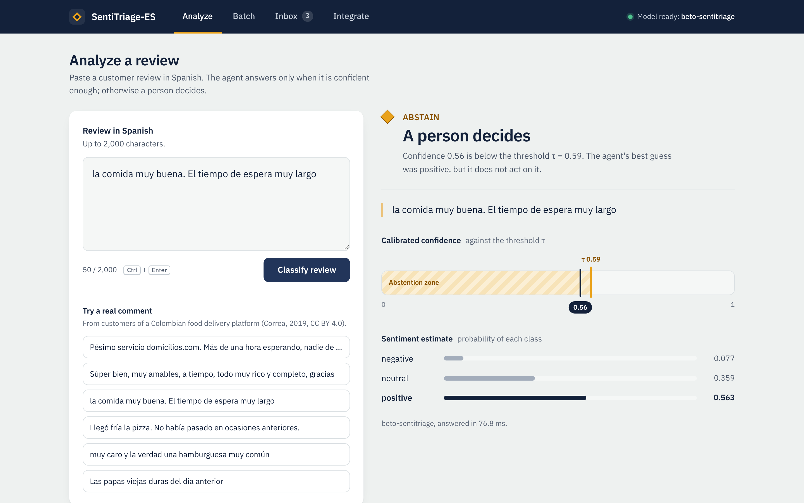
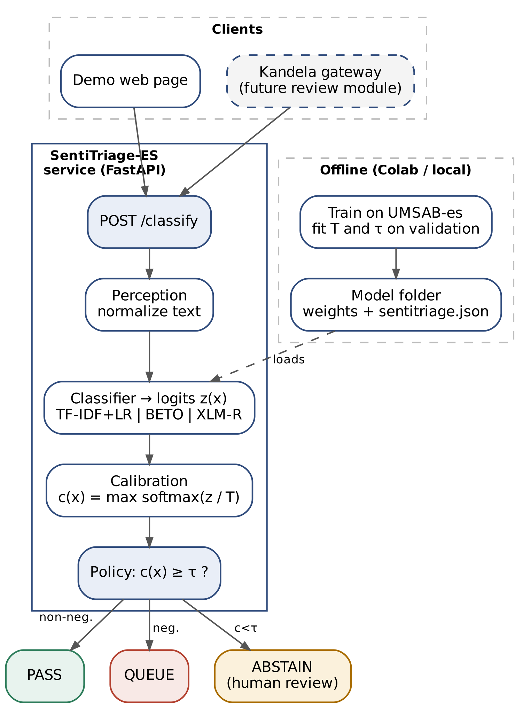
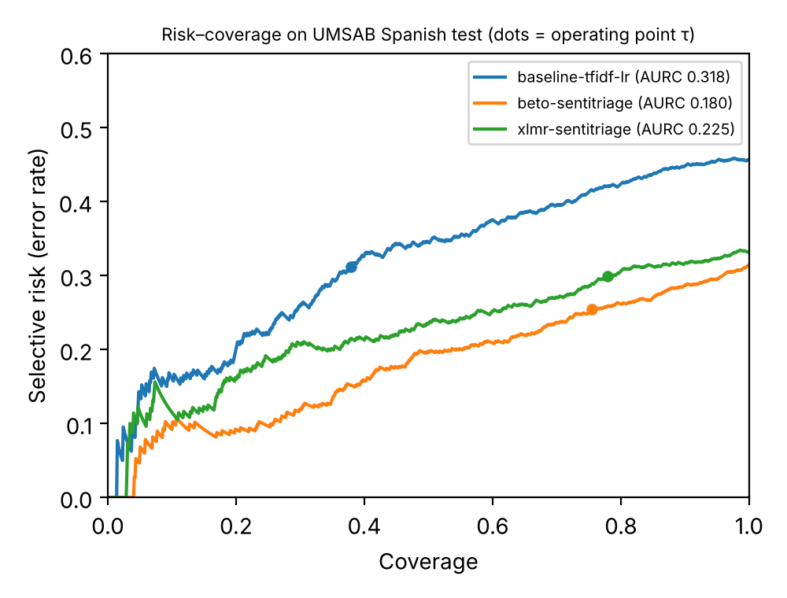

# SentiTriage-ES

**A Spanish sentiment agent that knows when not to decide.**

[](https://github.com/Rosa-SDev/sentitriage-es/actions/workflows/tests.yml)


SentiTriage-ES reads a restaurant review written in Spanish and labels it *negative*,
*neutral* or *positive*. It also calibrates its confidence. When it is not confident
enough, it **abstains** and passes the review to a person instead of guessing.



*"La comida muy buena. El tiempo de espera muy largo" mixes praise and a complaint.
Its calibrated confidence is 0.56, below τ = 0.59, so the agent sends it to a person.*

Spanish version: [README.es.md](README.es.md)

---

## How the agent decides

1. **Perceive.** Normalize the text: mentions, links, emojis and repeated letters.
2. **Classify and calibrate.** A fine-tuned BETO model returns logits *z(x)*.
   Temperature scaling, fitted on validation, gives the confidence
   *c(x) = max softmax(z(x) / T)*.
3. **Decide.**

| Action | Condition | Effect |
|---|---|---|
| `QUEUE` | c(x) ≥ τ and predicted negative | Goes to the administrator's complaint queue |
| `PASS` | c(x) ≥ τ and not negative | Stored automatically |
| `ABSTAIN` | c(x) < τ, or the model fails | A person decides |

τ is chosen on validation for a target selective risk of 0.25. A model failure never
becomes a silent PASS: it falls back to `ABSTAIN`.



## Results

### Spanish tweets, official UMSAB / XLM-T test set (n = 870)

| Model | Macro-F1 (95% CI) | ECE before → after T | Coverage at τ | Error: all → answered | Missed complaints: no abstention → policy |
|---|---|---|---|---|---|
| TF-IDF + LR (baseline) | 53.9 (50.6–57.3) | 0.093 → 0.042 | 38% | 46% → 31% | 109 → 29 |
| XLM-R base | 66.0 (62.9–69.1) | 0.115 → 0.065 | 78% | 33% → 30% | 77 → 46 |
| **BETO** | **68.8 (65.8–71.9)** | **0.165 → 0.042** | 76% | 31% → 25% | 85 → 48 |

Published references with the same split (Barbieri et al., 2022): FastText 50.1, XLM-R 65.9,
XLM-T 68.5. Our XLM-R reproduces the published value, and BETO matches the best one.



### Domain shift: real Colombian food-delivery comments

The models are trained and calibrated on tweets from Spain, then evaluated, with the same
*T* and τ and no refitting, on customer comments from a Colombian food-delivery platform
(Correa, 2019).

- **90 comments labeled by both authors independently.** Cohen's κ = 0.77 (raw agreement
  87.8%). The 11 disagreements were resolved by discussion. The star rating agrees with the
  human label in only 60% of cases, so the ratings are reported separately as weak labels.
- **BETO on the 90 human-labeled comments:** macro-F1 69.0 (95% CI 57.7–79.3),
  accuracy 0.79, negative recall 0.82. With abstention it answers 86% of the comments and
  the error drops from 21% to 16%.
- **What does not transfer:** calibration fitted on tweets does not improve ECE on this
  domain (0.098 → 0.111), and the neutral class is weak (F1 0.38, only 12 comments).
- **BETO on all 4,744 comments with rating labels:** macro-F1 57.7, mostly limited by label
  noise. Details in [`results/colombia/`](results/colombia/).

## Quick start

Python 3.10 or newer.

```bash
python -m venv .venv
source .venv/bin/activate            # Windows: .venv\Scripts\activate
pip install -r requirements.txt

python scripts/download_data.py      # downloads the Spanish UMSAB / XLM-T split
python experiments/run_baseline.py   # trains, calibrates and exports TF-IDF + LR
python -m pytest -q

uvicorn service.app:app --port 8000  # demo at http://localhost:8000, API docs at /docs
```

### API

```bash
curl -X POST localhost:8000/classify -H "Content-Type: application/json" \
     -d '{"text": "Pésimo servicio, más de una hora esperando el pedido."}'
```

| Endpoint | Purpose |
|---|---|
| `POST /classify` | One review → label, calibrated confidence, probabilities, action |
| `POST /classify/batch` | Up to 256 reviews |
| `GET /model` | Loaded model, *T*, τ and its test metrics |
| `GET /health` | Service status |

### Serving BETO

The transformers are fine-tuned on a Colab T4 GPU with
[`notebooks/02_finetune_transformers_colab.ipynb`](notebooks/02_finetune_transformers_colab.ipynb)
(4 epochs, lr 2e-5, batch 16, max length 128, seed 42). The notebook uses the same
`src/sentitriage/finetune.py` and `evaluate.py` as the local code and downloads the model
folder. Weights are not versioned.

```bash
pip install -r requirements-transformers.txt
SENTITRIAGE_MODEL_DIR=models/beto-sentitriage uvicorn service.app:app --port 8000
# PowerShell: $env:SENTITRIAGE_MODEL_DIR="models/beto-sentitriage"; uvicorn service.app:app --port 8000
```

Any folder with a `sentitriage.json` (backend, *T*, τ, metrics) can be served the same way.

## Repository layout

```
src/sentitriage/   library: data, perception, models, calibration, policy, evaluation
experiments/       reproducible scripts: EDA, baseline, comparison, error analysis, domain shift
scripts/           data download and preparation of the Colombian set
notebooks/         BETO and XLM-R fine-tuning on Colab
service/           FastAPI microservice and web demo (vanilla HTML/CSS/JS)
results/           metrics, predictions and figures produced by the experiments
data/colombia/     annotation sheets and labels for the Colombian sample
docs/              architecture decision record and figures
tests/             unit, service and fine-tuning smoke tests
```

## Integration

The agent runs as an independent HTTP service. It is designed to be called by
[Kandela](https://github.com/Rosa-SDev/kandela), a restaurant management system built
with microservices, so that the administrator sees the complaint queue and the abstained
reviews. See [ADR 0001](docs/decisions/0001-arquitectura.md).

## Data and licenses

- **Code:** MIT, see [LICENSE](LICENSE).
- **Tweets:** Spanish part of UMSAB / XLM-T (Barbieri et al., 2022), derived from InterTASS
  (SEPLN). The text is not redistributed here; `scripts/download_data.py` fetches it.
- **Colombian comments:** Correa, J. C. (2019). *Raw data of users' comments on online food
  delivery services* [Data set]. Mendeley Data, V1.
  https://doi.org/10.17632/k2v9sbmr8r.1 (CC BY 4.0). The derived files in `data/colombia/`
  keep that license.
- **IBM Plex fonts:** SIL Open Font License, see `service/static/fonts/`.

## References

- Barbieri, F., Espinosa Anke, L., & Camacho-Collados, J. (2022). XLM-T: Multilingual
  language models in Twitter for sentiment analysis and beyond. *LREC 2022*.
- Cañete, J., et al. (2020). Spanish pre-trained BERT model and evaluation data.
  *PML4DC at ICLR 2020*.
- Guo, C., Pleiss, G., Sun, Y., & Weinberger, K. Q. (2017). On calibration of modern neural
  networks. *ICML 2017*.
- Geifman, Y., & El-Yaniv, R. (2017). Selective classification for deep neural networks.
  *NeurIPS 2017*.
- Kamath, A., Jia, R., & Liang, P. (2020). Selective question answering under domain shift.
  *ACL 2020*.

## Authors

**Rosa Isabel Peña Yagüe** ([@Rosa-SDev](https://github.com/Rosa-SDev)) and
**Daniel Esteban Guzmán Rodríguez** ([@KraL-03](https://github.com/KraL-03)). Developed for Intelligent Systems 2026B,
Universidad de Ibagué, Colombia, under Prof. Alexandra La Cruz Puente.
